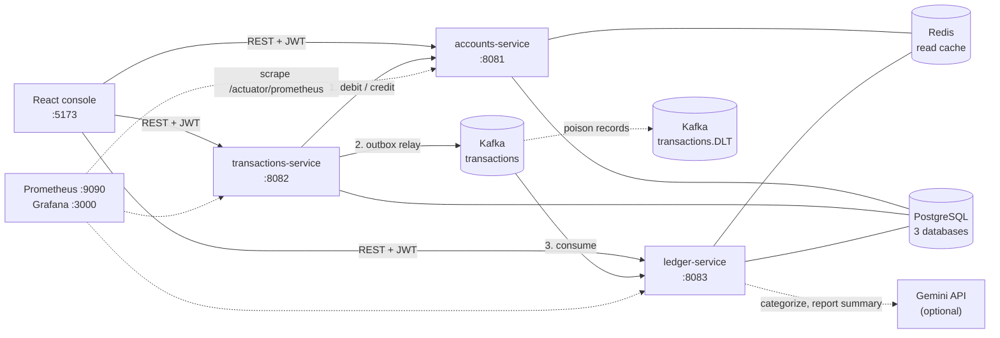

# LedgerGrid

**An event-driven payments sandbox with a tamper-evident, hash-chained ledger.**

LedgerGrid is a three-service Spring Boot system that moves money between accounts, records every completed transfer as an event on Kafka, and writes those events into an append-only ledger whose entries are linked by SHA-256 hashes. Editing, deleting or reordering any ledger row is detected by a single verification call that names the first broken entry.

It is built to show, end to end, how to keep a payment flow consistent and observable across service boundaries: idempotent writes, a transactional outbox, compensation with retries, dead-letter handling, schema migrations, metrics, and a scripted failure demo.

---

## Highlights

- **Three independent services**, each with its own PostgreSQL database: `accounts-service`, `transactions-service`, `ledger-service`.
- **Transactional outbox**: a transfer's `COMPLETED` status and its Kafka event are committed in the same database transaction, then published by a scheduled relay. An event can never be lost between the database commit and the broker.
- **Hash-chained ledger**: each entry stores the hash of the previous one. `GET /ledger/verify` re-derives every hash and reports exactly which entry no longer matches.
- **Idempotent transfers**: a client-supplied `Idempotency-Key` makes retries safe; the same key returns the original transaction instead of moving money twice.
- **Compensation with a retry queue**: if a credit fails after the sender was debited, the refund runs immediately, and if that also fails it is queued and retried with exponential backoff.
- **Dead-letter topic**: malformed or repeatedly failing Kafka records are routed to `transactions.DLT` instead of blocking the consumer.
- **Concurrency-safe chain appends**: a unique constraint on `chain_index` plus a bounded retry loop guarantees no two entries share a position in the chain.
- **JWT authentication** shared across all three services, a React console, and Flyway-managed schemas.
- **Observability**: Prometheus metrics and a pre-provisioned Grafana dashboard.
- **Rule-based anomaly detection** with an on-demand report and an optional Gemini-written summary.
- **Automated tests with real infrastructure** (Testcontainers) and a one-command chaos demo.

---

## Architecture



### How a transfer flows

1. The client calls `POST /transactions` on `transactions-service` with an `Idempotency-Key`.
2. `transactions-service` records the transfer as `PENDING`, then calls `accounts-service` synchronously: debit the sender, credit the receiver. Money movement needs an immediate answer, so this hop is REST.
3. On success, one database transaction marks the transfer `COMPLETED` **and** inserts an `outbox_event` row.
4. A scheduled relay publishes pending outbox rows to the `transactions` Kafka topic and marks them sent only after the broker acknowledges.
5. `ledger-service` consumes the event, categorizes it, runs the anomaly rules, links it to the chain tail, and stores it. Replayed events are recognized and skipped.

The ledger is deliberately off the payment path: if `ledger-service` is down, transfers keep succeeding, events wait in Kafka, and the ledger catches up when it returns (see the chaos demo below).

---

## Design decisions

| Concern | Approach | Why |
|---|---|---|
| Atomic "state change + event" | Transactional outbox (`outbox_event` table, scheduled relay) | Removes the dual-write gap between the database and Kafka. Delivery is at-least-once; the ledger consumer is idempotent. |
| Duplicate requests | `Idempotency-Key` header, unique constraint on the key | Retries and double-clicks return the original result; concurrent duplicates are resolved by the database. |
| Concurrent balance updates | Optimistic locking (`@Version`) on accounts | Prevents lost updates without long-held locks. |
| Partial failure | Compensating refund, then a `compensation_queue` retried with exponential backoff (5 attempts) | A debit is never silently stranded; exhausted items are marked `FAILED_PERMANENTLY` and logged for follow-up. |
| Tamper evidence | SHA-256 over each entry's content plus the previous entry's hash | Any edit, deletion or reordering breaks the chain and is pinpointed by `/ledger/verify`. |
| Two writers, one chain position | Unique `chain_index` + retry loop (up to 5 attempts, jittered backoff) | The database arbitrates; the loser re-reads the tail and retries instead of forking the chain. |
| Bad messages | `ErrorHandlingDeserializer`, `DefaultErrorHandler` with exponential backoff, `DeadLetterPublishingRecoverer` | Poison records go to `transactions.DLT` with their original bytes and failure headers; the partition keeps moving. |
| Schema ownership | Flyway `V1__baseline.sql` per service, Hibernate set to `validate` | Schemas are versioned and reviewed as SQL; the app refuses to start if entities and schema diverge. |
| Read performance | Redis cache on account and ledger reads, evicted on every write | Fast reads with no stale entries after a transfer. |
| AI features | Gemini for categorization and report narrative, behind rule-based fallbacks | Core flows never depend on an external API; without a key everything still works. |

---

## Quick start

**Prerequisites:** Docker (with Compose) and Node.js 20.19+ (or 22.12+). Java 21 and Maven are only needed to run the tests locally.

```bash
# 1. Start infrastructure and all three services
docker compose -f docker-compose.yml -f docker-compose.apps.yml up --build -d

# 2. Start the web console
cd frontend
npm install
npm run dev
```

Open **http://localhost:5173** and sign in with a demo user:

| User | Password | Role |
|---|---|---|
| `admin` | `admin123` | ADMIN |
| `user` | `user123` | USER |

From the console you can create accounts, execute transfers, retry a transfer with the same idempotency key, and run **Verify Ledger Integrity**.

To reset to a clean state: `docker compose -f docker-compose.yml -f docker-compose.apps.yml down -v`.

### Useful URLs

| What | URL |
|---|---|
| Web console | http://localhost:5173 |
| Grafana dashboard (`admin` / `admin`) | http://localhost:3000 |
| Prometheus | http://localhost:9090 |
| Kafka UI | http://localhost:8080 |

### Configuration

| Variable | Used by | Purpose |
|---|---|---|
| `JWT_SECRET` | all services | Shared HMAC signing secret (a local demo default is provided; set your own for anything beyond a local run). |
| `GEMINI_API_KEY` | ledger-service | Optional. Enables Gemini categorization and report narratives. Unset, the rule-based fallbacks are used. |
| `LLM_MODEL` | ledger-service | Optional Gemini model override. |

---

## API overview

All endpoints require `Authorization: Bearer <token>` unless listed under *Open endpoints*. Obtain a token from `POST /auth/login`.

| Service | Endpoint | Description |
|---|---|---|
| transactions | `POST /auth/login` | Exchange `{username, password}` for a JWT (1 hour). |
| transactions | `POST /transactions` | Execute a transfer. Optional `Idempotency-Key` header. |
| transactions | `GET /transactions/{id}` | Fetch a transaction and its status. |
| accounts | `POST /accounts`, `GET /accounts/{id}` | Create and read accounts. |
| accounts | `POST /accounts/{id}/credit`, `/debit` | Balance operations (used by transactions-service). |
| ledger | `GET /ledger`, `GET /ledger/account/{id}` | Ledger entries, newest first. |
| ledger | `GET /ledger/report?since=24h` | Aggregated report: totals, flagged entries, category breakdown, optional AI narrative. |

**Open endpoints** (no token, so they can be used in demos): `/actuator/**` (health and metrics), `GET /ledger/verify`, `/auth/login`, and the `/dev/**` fault-injection helper used by the console's "simulate backend error" control.

### Anomaly detection

Every ledger entry is evaluated by explainable rules at write time and flagged with a machine-readable reason:

- `AMOUNT_OUTLIER`: the amount is well above the sender's own history (mean + 3 standard deviations, with absolute floors for new accounts).
- `FREQUENCY_SPIKE`: six or more transfers from one sender within 60 seconds.

`GET /ledger/report` summarizes flagged entries. When a Gemini key is configured, the aggregate (counts, categories, flagged items) is summarized into a short narrative; otherwise the structured report is returned on its own.

---

## Failure demo

`scripts/chaos-demo.sh` walks through a live failure and recovery against the running stack and narrates each step:

1. Log in and run a normal transfer.
2. Stop `ledger-service`.
3. Run more transfers while it is down; the script prints the growing Kafka consumer lag.
4. Start `ledger-service` again and watch the backlog drain into the ledger.
5. Edit one ledger row directly in PostgreSQL, then call `/ledger/verify` and see it identify the exact entry that was altered.

```bash
./scripts/chaos-demo.sh     # run from the repo root, with the stack up (Git Bash on Windows)
```

The script leaves the edited row in place so you can inspect it; run the `down -v` command above to reset before the next demo.

---

## Testing

- **Unit tests** cover transfer orchestration, the outbox publisher, compensation retry logic, anomaly rules, hash chaining, security, and the chain-append retry loop.
- **Integration tests on real infrastructure (Testcontainers)** run against PostgreSQL, Kafka and Redis containers:
  - compensation queue: a failed refund is queued, retried with backoff, and resolves (or is marked `FAILED_PERMANENTLY` at the retry cap);
  - dead-letter topic: a malformed message lands on `transactions.DLT` while the valid message behind it is still recorded;
  - chain concurrency: simultaneous `record()` calls never produce a duplicate `chain_index`, and the chain still verifies.
- **End-to-end test** (`integration-tests/`): builds the three services from their Dockerfiles, starts them on a Docker network with Postgres, Kafka and Redis, logs in over HTTP, performs a transfer, and asserts the ledger entry appears, `/ledger/verify` is valid, and balances are correct.

```bash
# per service (Docker must be running for the Testcontainers-based tests)
cd accounts-service && ./mvnw test
cd transactions-service && ./mvnw test
cd ledger-service && ./mvnw test

# full end-to-end flow (the first run builds the service images)
cd integration-tests && mvn test
```

GitHub Actions builds and tests each service on every push to `main` and on pull requests.

---

## Observability

Each service exposes `/actuator/prometheus`. Prometheus scrapes all three, and Grafana starts with a provisioned **LedgerGrid Overview** dashboard (no manual setup) covering:

- transaction throughput by status (`COMPLETED` / `FAILED`),
- Kafka consumer lag,
- Redis cache hit ratio, hits/misses and evictions,
- ledger write latency.

Additional counters track outbox/compensation activity (for example `compensation.queued` and `compensation.retries`).

---

## Repository structure

```text
.
├── accounts-service/        # Accounts, balances, optimistic locking, JWT validation
├── transactions-service/    # Transfer orchestration, idempotency, outbox, compensation, /auth/login
├── ledger-service/          # Kafka consumer, hash chain, verification, anomaly rules, reports, DLT
├── frontend/                # React + TypeScript console
├── integration-tests/       # End-to-end Testcontainers test
├── scripts/chaos-demo.sh    # Scripted failure/recovery/tamper demo
├── prometheus/              # Scrape configuration
├── grafana/                 # Provisioned datasource and dashboard
├── init-db.sql              # Creates the three service databases
├── docker-compose.yml       # Infrastructure: Postgres, Kafka, Redis, Kafka UI, Prometheus, Grafana
└── docker-compose.apps.yml  # The three Spring Boot services
```

Each service keeps its schema in `src/main/resources/db/migration/V1__baseline.sql`.

---

## Technology

Java 21 · Spring Boot 3.4 · Spring Data JPA · Spring Security (JWT) · Spring Kafka · PostgreSQL 16 · Flyway · Redis 7 · Apache Kafka 3.9 (KRaft) · Micrometer · Prometheus · Grafana · React 19 · TypeScript · Vite · Tailwind CSS 4 · Google Gemini API (optional) · Docker Compose · Testcontainers · GitHub Actions
