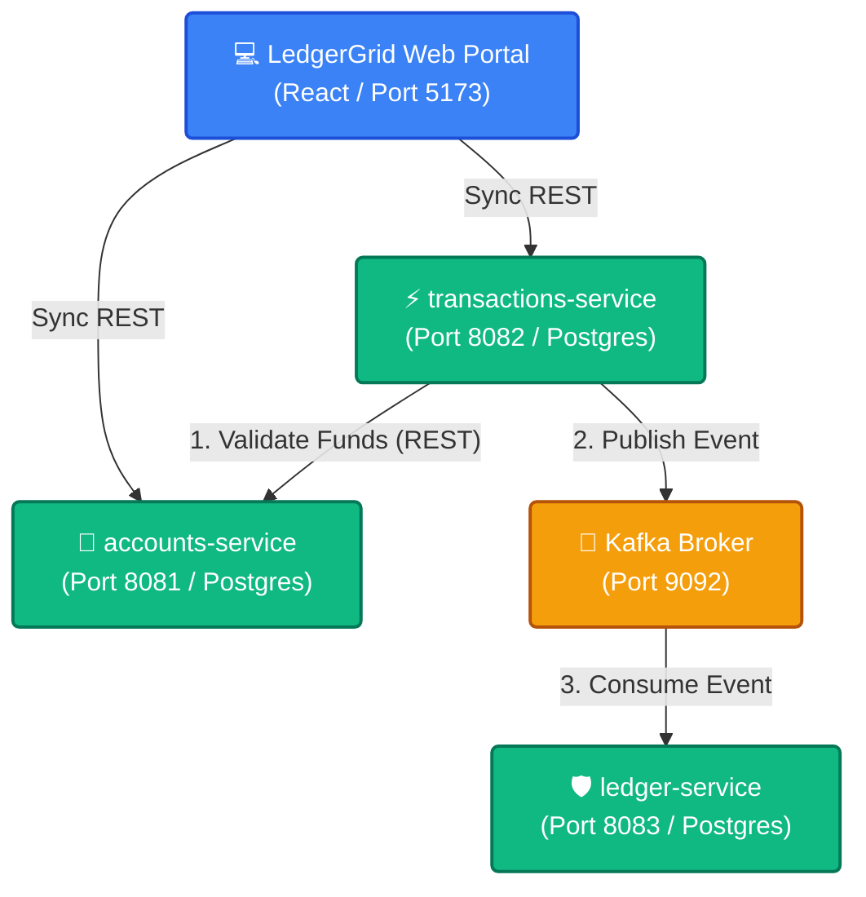

# LedgerGrid: Distributed Transaction Ledger Sandbox

LedgerGrid is a robust, distributed microservices architecture designed to simulate high-throughput transaction processing while maintaining a cryptographic audit trail. It securely processes fund transfers between accounts using synchronous REST validations, publishes event-driven asynchronous logs via Apache Kafka, and constructs a blockchain-inspired immutable ledger.

A responsive React frontend serves as the control center, allowing you to trigger transfers, monitor message broker events, and validate ledger integrity in real-time.

---

## 🛠️ Technology Stack
*   **Backend Services**: Java 21 · Spring Boot 3.4 · Spring Data JPA · PostgreSQL 16 · Redis 7
*   **Event Streaming**: Apache Kafka 3.9 (KRaft mode)
*   **Frontend**: React 18 · TypeScript · Vite · Tailwind CSS v4 · Lucide Icons
*   **AI Integration**: Google Gemini API (with deterministic fallback mechanisms)
*   **DevOps & Deployment**: Docker Compose · GitHub Actions

---

## 🏛️ System Architecture



### 1. Synchronous vs. Asynchronous Hops
*   **Transactions ➔ Accounts (REST)**: Financial movements require immediate consistency. Debiting an account triggers a real-time balance check and synchronous lock. If funds are insufficient, the transaction is rejected outright.
*   **Transactions ➔ Ledger (Kafka)**: The ledger serves as an immutable history and must not bottleneck the primary payment pipeline. Should the ledger service experience downtime, Kafka buffers the `transaction.completed` events, allowing the ledger to catch up sequentially with zero data loss once restored.

### 2. Idempotency and Deduplication
To prevent accidental double-charging (e.g., from network retries or enthusiastic button mashing), the portal generates a deterministic SHA-256 idempotency key from the core transaction attributes:
$$\text{Key} = \text{SHA-256}(\text{Debit Acc} + \text{Credit Acc} + \text{Amount} + \text{Merchant} + \text{Description} + \text{Time Bucket})$$
If an identical request arrives within the timeframe window, a unique constraint in the PostgreSQL database intercepts the request, returning the original response without executing a duplicate funds transfer.

### 3. Cryptographically Secured Ledger
The ledger service records all activities in an append-only chain format. Each new entry calculates its hash by combining its own payload with the hash of the preceding block. Any tampering—whether modification, deletion, or reordering—breaks the continuous chain, making data corruption instantly detectable.

### 4. Cache Management Strategy
Redis is employed to accelerate account balance retrievals and ledger queries. To prevent stale data, write operations trigger immediate cache evictions: account updates flush the balance cache, and new ledger blocks invalidate the ledger list cache.

---

## 📂 Repository Structure

```text
ledgergrid/
├── README.md                   # Project documentation
├── docker-compose.yml          # Core infra: Postgres, Kafka, UI, Redis
├── docker-compose.apps.yml     # Java microservices definitions
├── init-db.sql                 # Database seeding instructions
├── .github/workflows/ci.yml    # CI/CD pipelines
├── accounts-service/           # Account balances and locks
├── transactions-service/       # Transfer orchestration
├── ledger-service/             # Audit trailing and AI categorization
└── frontend/                   # React control portal
```

---

## 🔌 Service Port Registry

| Service | Port | Infrastructure | Responsibility |
|:---|:---|:---|:---|
| **accounts-service** | `8081` | `accounts_db` (Postgres) | Manages funds; handles optimistic locking (`@Version`). |
| **transactions-service** | `8082` | `transactions_db` (Postgres) | Coordinates transfers, records states, produces messages. |
| **ledger-service** | `8083` | `ledger_db` (Postgres) | Ingests Kafka events, builds the hash chain, utilizes Gemini API. |
| **frontend-service** | `5173` | — | Single-page interactive management interface. |
| **kafka** | `9092` | KRaft Broker | Core event topic: `transactions`. |
| **kafka-ui** | `8080` | — | Monitoring UI: [http://localhost:8080](http://localhost:8080). |
| **redis** | `6379` | — | In-memory caching for read-heavy operations. |

---

## 🚀 Running the Sandbox

### Step 1. Booting the Infrastructure
From the project root, launch the backend databases, message brokers, and microservices:
```bash
docker compose -f docker-compose.yml -f docker-compose.apps.yml up --build -d
```
> *Need a clean slate? Run `docker compose -f docker-compose.yml -f docker-compose.apps.yml down -v` to wipe all data.*

### Step 2. Launching the Web Portal
Navigate into the frontend directory to start the development server:
```bash
cd frontend
npm install
npm run dev
```
Open **[http://localhost:5173](http://localhost:5173)** in your browser to access the dashboard.

---

## 💻 Portal Interface Features

### � Modern Banking Theme
*   Features a clean, minimalist design utilizing deep corporate blues and sharp alert red accents to build trust and usability.
*   **Optimized Layout**: Engineered to occupy exactly `100vh` to eliminate jarring window scrolls. Component panels handle their own overflow elegantly.
*   **Non-Blocking Notifications**: Action results slide in as floating toast alerts, preserving the grid layout and ensuring the interface remains stable during rapid interactions.

### ⚡ Idempotency Sandbox Monitor
*   Initiating a transfer renders a live 10-second processing window in the interface.
*   While active, attempting to re-submit the same "Execute Transfer" command mimics a duplicate network payload.
*   The system logs will immediately flag the duplicate request being blocked by the backend's deterministic hash constraints, safely resolving without impacting account balances.
